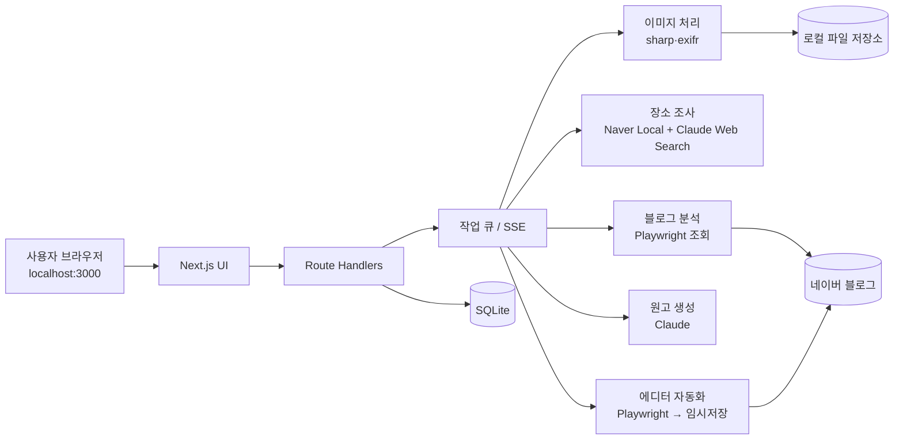

# 네이버 블로그 방문 후기 자동 작성·임시저장 서비스 — 개발 설계서

| 항목 | 내용 |
|---|---|
| 문서 버전 | v0.1 (프로토타입 설계) |
| 작성일 | 2026-11-06 |
| 대상 | Claude Code로 한 번에 구현할 수 있는 수준의 상세 설계 |
| 서비스 가칭 | **방문기록 (Visit Draft)** |
| 디자인 기준 | Apple 디자인 스킬 (14장 참고) |

---

## 1. Executive Summary (결론 먼저)

1. **형태: 내 PC에서 실행하는 로컬 웹앱 (localhost)**
   - 네이버 블로그는 **글쓰기 공식 API가 종료**되었습니다(2020-05-06, 2장 근거 참고).
   - 따라서 임시저장은 **실제 브라우저를 자동 조작(Playwright)** 하는 방식으로만 구현할 수 있습니다.
   - 네이버 로그인 세션을 외부 서버에 두지 않기 위해, 사용자 PC에서 실행하는 형태로 만듭니다.
2. **언어: TypeScript 단일 스택**
   - Next.js(UI·API), Playwright(Node, 에디터 자동화), Anthropic SDK(사진 분석·웹 검색·글 생성), SQLite(로컬 저장).
3. **핵심 흐름**
   - 사진(최대 20장)과 장소명, 대상 블로그·카테고리를 입력받습니다.
   - ① 과거 글 분석으로 문체·템플릿 프로필 생성 → ② 장소 정보 조사(네이버 지역검색 + 웹 검색) → ③ 사진 분석 → ④ 블록 단위 원고 생성 → ⑤ **사용자 미리보기·수정** → ⑥ 스마트에디터에 입력 후 **임시저장(발행 금지)**.
4. **최대 리스크: 에디터 자동화의 불안정성과 네이버 운영정책**
   - 이에 대응하기 위해 PoC(0단계)로 "임시저장 자동화 가능 여부"를 먼저 검증합니다.
   - 모든 화면 선택자(selector)는 설정 파일로 분리합니다.
   - 실패하면 "복사·붙여넣기용 원고 내보내기"로 대체합니다.
5. **추가 제안 기능(필수에 가까움):** 방문 메모 입력, 원고 미리보기·편집, 사진 위치정보(GPS) 제거, EXIF 기반 사진 정렬, 협찬 표기 옵션 등 (7장).

---

## 2. Agenda Framing → MECE 질문 → 가설 → 근거 매트릭스

### 2.1 Agenda (풀어야 할 문제)

> "사용자가 사진과 장소명만 주면, **그 블로그의 평소 스타일 그대로** 정확한 후기 초안을 만들어 **네이버 블로그 임시저장함**에 넣어줄 수 있는가?"

### 2.2 MECE 핵심 질문과 가설

| # | 질문 영역 | 핵심 질문 | 가설 | 검증 결과 |
|---|---|---|---|---|
| Q1 | 저장 경로 | 네이버 블로그에 글을 프로그램으로 넣을 수 있는가? | 공식 API는 없고, 브라우저 자동화만 가능하다 | **사실로 확인**: 글쓰기 API는 2020-05-06 종료(라이브러리 공지), 2025-02 커뮤니티 답변도 종료로 안내. 시중 자동 포스팅 도구는 Playwright 기반 |
| Q2 | 임시저장 | 발행 없이 임시저장만 할 수 있는가? | 에디터의 "저장" 버튼을 눌러 가능하다 | **추정**: 공식 API에는 없음. 에디터 UI 조작으로 가능할 것으로 보이며 PoC로 확인 필요 |
| Q3 | 스타일 학습 | 과거 글을 조회해 양식을 뽑을 수 있는가? | 공개 글은 브라우저로 읽어 HTML 구조를 분석할 수 있다 | **추정**: 공식 조회 API 없음. RSS 또는 모바일 페이지 조회로 구현하고 PoC에서 확인 |
| Q4 | 장소 정보 | 장소 사실 정보를 어디서 확보하는가? | 네이버 지역검색 API와 웹 검색을 조합한다 | **사실로 확인**: 네이버 검색 API는 NAVER Cloud API HUB로 제공. 지역검색은 1회 최대 5건, 현재 한시적 무료 |
| Q5 | 사진 활용 | 사진 20장을 글에 맞게 배치할 수 있는가? | Claude 비전으로 장면을 분석해 순서·설명을 만든다 | 설계로 해결(9.3장) |
| Q6 | 신뢰성 | 경험하지 않은 내용이 사실처럼 쓰이는 위험이 있는가? | 맛·가격·서비스 평가는 AI가 알 수 없다 | **설계 반영**: 방문 메모 입력과 "근거 없는 평가 금지" 규칙 (9.4장) |
| Q7 | 정책·법 | 계정 제재나 법적 문제의 위험은 있는가? | 대량·반복 자동화는 제재 위험이 있다 | **위험 존재**: 판매자 스스로 "차단될 수 있음"이라고 고지. 임시저장 전용, 사람 검수, 속도 제한으로 완화 |

### 2.3 근거 매트릭스 (Evidence Matrix)

| 근거 | 출처 | 날짜 | 신뢰도 | 관련 질문 |
|---|---|---|---|---|
| "2020년 5월 6일부로 네이버 API 서비스 종료로 사용 불가" | [yousung/laravel-naver-blog-xmlrpc README](https://github.com/yousung/laravel-naver-blog-xmlrpc) | 미표기 | 중 (비공식) | Q1 |
| "네이버 블로그는 진작에 API 기능이 종료" | [인프런 Q&A](https://www.inflearn.com/community/questions/1513877) | 2025-02 | 중 (비공식) | Q1 |
| 자동 포스팅 도구가 Playwright 기반이며 "차단 가능"이라고 고지 | [크몽 상품 페이지](https://kmong.com/gig/683489) | 2026 | 중 | Q1, Q7 |
| 네이버 검색 API가 API HUB로 제공, 종량제이며 현재 한시 무료 | [NAVER Cloud API HUB 개요](https://api.ncloud-docs.com/docs/naver-api-hub-overview.md) | 2026-09 | 상 (공식) | Q4 |
| 지역검색 display 1~5, 하루 25,000회 / 검색 카테고리 월 775,000회 (문서 간 상이) | [지역검색 문서](https://api.ncloud-docs.com/docs/naver-api-hub-search-local), [API HUB 가이드](https://guide.ncloud-docs.com/docs/apihub-overview) | 미표기 | 상 (공식, 단 문서 간 충돌) | Q4 |

> 이 장에서 "추정"으로 표시한 항목(Q2, Q3)은 0단계 PoC에서 반드시 검증합니다. 검증 전에는 기능이 확정된 것으로 보지 않습니다.

---

## 3. 범위

### 3.1 포함 (프로토타입 v0.1)

| ID | 기능 | 요청 출처 |
|---|---|---|
| F1 | 사진 업로드 (최대 20장) | 사용자 요구 |
| F2 | 장소명 입력과 후보 선택 | 사용자 요구 |
| F3 | 장소 정보 웹 조사 | 사용자 요구 |
| F4 | 대상 블로그 주소·카테고리(경로) 선택 | 사용자 요구 |
| F5 | 대상 블로그 과거 글 분석 → 템플릿·문체 프로필 | 사용자 요구 |
| F6 | 사진을 활용한 원고 생성 (같거나 유사한 템플릿) | 사용자 요구 |
| F7 | 지정 카테고리에 **임시저장** (발행 금지) | 사용자 요구 |
| F8 | 네이버 로그인 세션 연결 (자동화 전제 조건) | 설계상 필수 |
| A1~A10 | 추가 제안 기능 | 7장 |

### 3.2 제외 (이후 단계)

- 자동 발행, 예약 발행
- 다른 블로그 플랫폼(티스토리 등)
- 클라우드 다중 사용자 서비스 (13.3장 확장 방향 참고)

---

## 4. 기술 선택과 근거

### 4.1 서비스 형태 비교

| 후보 | 장점 | 단점 | 판단 |
|---|---|---|---|
| **로컬 웹앱 (localhost)** | 네이버 세션이 내 PC에만 있음, 캡차·2단계 인증을 사용자가 직접 처리 가능, 서버 비용 없음 | PC가 켜져 있어야 함 | **채택** |
| 클라우드 웹서비스 | 어디서나 접속 가능 | 서버 IP 로그인으로 보안 경고·차단 위험, 타인 계정 세션 보관 부담 | 보류 |
| 크롬 확장 프로그램 | 이미 로그인된 브라우저 활용 | 대용량 이미지 처리와 AI 호출 구조가 복잡함 | 2단계 검토 |
| 데스크톱 앱 (Electron/Tauri) | 설치형 배포에 유리 | 초기 개발 부담 | 로컬 웹앱 검증 후 감싸기 |

### 4.2 기술 스택

| 영역 | 선택 | 이유 |
|---|---|---|
| 언어 | TypeScript (Node.js LTS) | Playwright·Next.js·Anthropic SDK를 한 언어로 처리 |
| 프론트·API | Next.js (App Router) + React | 화면과 API를 한 프로젝트로 관리 |
| 스타일 | CSS 변수 기반 디자인 토큰 + Tailwind CSS | Apple 스타일 토큰을 일관되게 적용 |
| 브라우저 자동화 | Playwright (`launchPersistentContext`) | 로그인 세션 유지, 파일 업로드, 안정적인 대기 처리 |
| AI | Anthropic SDK (Claude: 비전 + 웹 검색 도구 + 구조화 출력) | 사진 분석, 장소 조사, 글 생성을 한 공급자로 처리 |
| 장소 API | NAVER API HUB 지역검색 `/search/v1/local` | 정확한 상호·주소·카테고리 확보 |
| 이미지 | `sharp`(리사이즈), `heic-convert`(아이폰 HEIC), `exifr`(촬영일·GPS) | 아이폰 사진 대응, AI 전송 용량 절감 |
| DB | SQLite + Drizzle ORM | 설치 없이 동작하는 로컬 DB |
| 검증 | `zod` | AI 출력 JSON 스키마 검증 |
| 작업 처리 | 프로세스 내 큐 (`p-queue`) + SSE 진행 상황 전송 | 단일 사용자 로컬 환경에 충분 |
| 테스트 | Vitest(단위), Playwright Test(E2E) | — |

> 라이브러리 버전은 구현 시점의 최신 안정 버전을 사용하고, `package.json`에 고정합니다.

---

## 5. 시스템 구조



**처리 단계(Job Pipeline)**

```
CREATED → IMAGES_PROCESSED → STYLE_READY → PLACE_RESEARCHED
        → IMAGES_ANALYZED → DRAFT_GENERATED → USER_REVIEWED
        → SAVING_TO_NAVER → SAVED_AS_DRAFT   (실패 시 FAILED + 단계별 재시도)
```

- 단계별 결과를 DB에 저장해, 실패한 단계부터 다시 실행할 수 있게 합니다.
- STYLE과 PLACE 단계는 서로 독립적이므로 병렬로 실행합니다.

---

## 6. 기능 상세 명세 (필수 기능)

### F8. 네이버 계정 연결 (최초 1회)

- [설정] → [네이버 연결]을 누르면 Playwright가 **화면이 보이는 크롬 창**을 엽니다.
- 사용자가 네이버에 **직접 로그인**합니다. 앱은 아이디와 비밀번호를 입력받지도, 저장하지도 않습니다.
- 로그인 완료를 감지하면 세션을 `data/browser-profile/` 폴더(사용자 데이터 디렉터리)에 유지합니다.
- 상태 표시: `연결됨 (블로그 ID)` / `만료됨 — 다시 로그인`.
- 작업 전마다 세션이 유효한지 확인합니다. 만료되었으면 재로그인 창을 띄우고 대기합니다.
- 캡차나 새 기기 확인이 나오면 자동으로 처리하지 않고 사용자에게 처리를 요청합니다.

### F4. 대상 블로그·경로 선택

- 입력 형식: 블로그 주소. 아래 형식을 모두 해석합니다.
  - `blog.naver.com/{blogId}`
  - `m.blog.naver.com/{blogId}`
  - `blog.naver.com/{blogId}/{logNo}`
  - `blog.naver.com/PostList.naver?blogId=...&categoryNo=...`
- **권한 확인:** 로그인한 계정이 해당 블로그에 글을 쓸 수 있는지 확인합니다(본인 블로그 여부). 쓸 수 없으면 "분석만 가능, 저장 불가"로 표시합니다.
- **경로(카테고리) 목록:** 로그인된 브라우저에서 블로그 카테고리 트리를 읽어 드롭다운으로 보여줍니다(하위 카테고리 포함).
- 최근 사용한 블로그·카테고리 조합을 "즐겨찾기"로 저장합니다.

### F5. 과거 글 분석 → 스타일 프로필

**수집**

- 선택한 카테고리의 최근 글 **N편(기본 10, 최대 20)** 을 조회합니다. 카테고리 글이 3편 미만이면 블로그 전체 최신 글로 보충합니다.
- 조회 순서:
  1. RSS (`rss.blog.naver.com/{blogId}.xml`)
  2. 모바일 글 목록·본문 페이지를 Playwright로 조회
- 위 경로는 모두 **비공식**이므로 PoC에서 동작을 확인합니다.
- 요청 간격은 1~3초 무작위로 두어 서버 부담을 줄입니다.

**정량 분석 (코드로 계산)**

- 스마트에디터 ONE의 HTML 블록 클래스(`se-component`, `se-text`, `se-image`, `se-quotation`, `se-sectionTitle`, `se-horizontalLine`, `se-placesMap`, `se-sticker` 등)를 파싱합니다.
- 계산 항목: 블록 순서 패턴, 사진·문단 비율, 평균 문단 길이, 사진 연속 배치 수, 인용구·구분선·지도 사용 여부, 해시태그 수, 제목 길이와 패턴.
- 클래스명은 바뀔 수 있으므로 `config/selectors.json`으로 관리합니다.

**정성 분석 (Claude)**

- 대상: 서두 인사, 말투(존댓말·반말, "~했어요" / "~했다"), 이모지·특수기호 습관, 소제목 형식(예: `📍 위치`, `■ 메뉴`), 마무리 문구, 정보 박스(주소·영업시간) 형식.

**결과물: `StyleProfile` JSON** (스키마는 8장)

- 사용자가 화면에서 확인하고 수정할 수 있습니다.
- 블로그·카테고리별로 저장하고, 7일 동안 캐시합니다.

### F1. 사진 업로드

| 규칙 | 값 |
|---|---|
| 개수 | 1~20장 (21장째부터 거부 안내) |
| 형식 | JPG, PNG, HEIC/HEIF, WEBP |
| 파일당 크기 | 30MB 이하 (앱 정책) |
| 순서 | 드래그로 변경. 기본은 EXIF 촬영 시각 순 |
| 대표 사진 | 1장 지정 (기본은 첫 장) |

- **업로드 직후 처리:**
  - HEIC는 JPG로 변환합니다.
  - 원본은 보관합니다.
  - AI 분석용으로 긴 변 1,568px 이하 사본을 만듭니다.
  - 네이버 업로드용 사본을 만듭니다. 기본은 원본을 쓰되, 옵션으로 긴 변 3,000px까지 줄일 수 있습니다.
- **개인정보:** 네이버 업로드용 사본은 기본적으로 **GPS 등 EXIF를 제거**합니다(A4).

### F2·F3. 장소 입력과 정보 조사

1. **장소 후보 확정**
   - 사용자가 장소명을 입력하면 NAVER API HUB 지역검색으로 최대 5개 후보를 가져옵니다. 받아오는 정보는 상호, 카테고리, 도로명 주소, 링크입니다.
   - 사용자가 후보 하나를 선택합니다. 사진 EXIF의 GPS가 있으면 가장 가까운 후보를 자동으로 추천합니다.
   - 후보가 없으면 "직접 입력"(상호와 주소)을 허용합니다.
2. **보강 조사:** Claude의 웹 검색 도구로 아래 항목을 조사합니다.
   - 영업시간, 휴무일, 대표 메뉴와 가격대, 주차, 예약, 특징, 최근 변동 사항(이전·폐업 여부).
   - 장소 유형별로 항목을 바꿉니다. 예: 관광지는 입장료와 소요 시간, 카페는 좌석과 콘센트.
3. **출력: `PlaceFacts` JSON**
   - 각 항목에 `value`, `sources[]`(URL), `confidence`(high/medium/low), `checkedAt`을 붙입니다.
   - 출처가 없는 항목은 비워 둡니다. **추측으로 채우지 않습니다.**
   - 서로 충돌하는 정보는 `conflict: true`로 표시하고, 화면에서 사용자에게 선택을 요청합니다.
4. **다른 블로그 글은 참고만 합니다.** 문장을 그대로 옮기지 않습니다. 생성된 원고와 참고 글의 유사도를 검사합니다(9.4장).

### F6. 원고 생성

- **입력:** `StyleProfile`, `PlaceFacts`, `ImageInsight[]`, `VisitMemo`(A1), 옵션(길이, 협찬 표기, 해시태그 수).
- **출력:** `PostDraft` JSON. 블록 배열 형태입니다(8장).
- 생성 방식은 9.4장을 따릅니다.
- **모든 사진을 사용하는 것이 기본**입니다. 흔들리거나 중복된 사진은 "제외 추천"으로 표시하고, 실제 제외 여부는 사용자가 정합니다.
- 화면 기능: 원고 미리보기(블로그 모양에 가깝게), 블록 단위 수정, 문단 재생성, 사진 순서 변경, 제목 후보 3개 중 선택.

### F7. 네이버 임시저장 (발행 금지)

**절차 (Playwright, 화면이 보이는 모드 기본)**

1. 세션이 유효한지 확인합니다.
2. 글쓰기 페이지를 엽니다: `https://blog.naver.com/{blogId}?Redirect=Write` 또는 그에 준하는 경로. 정확한 주소는 PoC에서 확정합니다.
3. "작성 중인 글이 있습니다" 같은 팝업이 뜨면 **기존 임시글을 덮어쓰지 않도록** "새로 작성"을 선택합니다.
4. 제목을 입력합니다.
5. 본문 블록을 순서대로 입력합니다.
   - **텍스트:** 클립보드 붙여넣기 또는 `keyboard.type`. 줄바꿈과 문단을 유지합니다.
   - **소제목·인용구·구분선:** 에디터 도구 막대의 해당 버튼을 누른 뒤 텍스트를 입력합니다.
   - **사진:** 사진 버튼 → 파일 선택 창 → `setInputFiles`로 업로드 → 업로드 완료까지 대기 → 설명(캡션) 입력(선택).
   - **장소(지도):** 장소 버튼에서 검색 후 첨부합니다. 실패하면 텍스트 정보 박스로 대체합니다.
6. 카테고리를 지정합니다. ⚠️ 임시저장 상태에서도 카테고리가 지정되는지는 PoC에서 확인해야 합니다. 지정되지 않으면 본문 맨 위에 `[저장 예정 카테고리: ○○]` 메모를 넣고 사용자에게 알립니다.
7. **"저장"(임시저장) 버튼만 누릅니다.**
   - **"발행" 버튼은 코드에서 누를 수 없도록 차단합니다.** 발행 버튼 선택자를 거부 목록에 넣고, 클릭 함수에 가드를 둡니다.
8. 저장이 완료된 것을 확인합니다(토스트 메시지 또는 임시저장 목록 개수 증가). 증거 스크린샷을 저장합니다.
9. 결과를 화면에 안내합니다: "임시저장 완료 — 네이버 글쓰기 > 저장 글 목록에서 확인하세요".

**안정성 규칙**

- 모든 동작은 `waitFor` 기반으로 처리합니다. 고정 시간 `sleep`은 쓰지 않습니다.
- 단계별로 타임아웃과 최대 2회 재시도를 둡니다.
- 선택자는 `config/selectors.json`에 둡니다. 우선순위는 role/label → text → CSS입니다.
- 실패하면 그 시점의 스크린샷과 HTML 스냅샷을 `data/debug/`에 저장합니다.
- **대체 방안(Fallback):** 자동화가 실패하면 "원고 내보내기"(사진 ZIP + 본문 HTML/텍스트)를 제공해 사용자가 직접 붙여넣을 수 있게 합니다.

---

## 7. 추가 제안 기능

| ID | 기능 | 필요한 이유 | 우선순위 |
|---|---|---|---|
| **A1** | **방문 메모** (방문일, 동행, 주문 메뉴, 맛·서비스 평가, 별점, 아쉬운 점; 자유 메모 가능) | AI는 실제 경험(맛, 서비스)을 알 수 없습니다. 메모 없이 쓰면 **사실과 다른 후기**가 될 위험이 큽니다 | 필수 |
| **A2** | 원고 미리보기·편집·문단 재생성 | 저장 전에 사람이 검수하는 단계. 품질과 정책 리스크를 함께 완화 | 필수 |
| A3 | EXIF 기반 자동 정렬과 방문일 자동 입력 | 사진 순서 = 동선이라 글 흐름이 자연스러워짐 | 높음 |
| **A4** | 업로드 사진의 GPS·EXIF 제거 (기본 ON) | 집 주변 사진 등에서 위치 노출 방지 | 필수 |
| A5 | 사진 품질 점검 (흐림, 중복, 비슷한 사진 묶기) | 20장 중 불필요한 사진 정리 | 중간 |
| A6 | 얼굴·차량번호판 흐림 처리 (선택) | 타인 초상권과 개인정보 보호 | 중간 |
| A7 | 협찬·광고 표기 옵션 (문구 선택 후 글 상단에 삽입) | 협찬 후기의 표시 의무 대응. 문구는 최신 공정위 지침을 확인해 템플릿화 | 중간 |
| A8 | 해시태그·제목 후보 추천 (기존 글의 태그 패턴 반영) | 검색 노출과 일관성 | 중간 |
| A9 | 작업 이력 (생성한 원고, 사용한 출처, 저장 스크린샷) | 재사용, 확인, 문제 추적 | 중간 |
| A10 | 스타일 프로필 편집·고정 | 분석 결과를 사용자가 다듬어 재사용 | 낮음 |

---

## 8. 데이터 모델

### 8.1 테이블 (SQLite)

| 테이블 | 주요 컬럼 |
|---|---|
| `blogs` | id, blog_id, title, is_owner, last_checked_at |
| `categories` | id, blog_id, category_no, name, parent_no, path |
| `style_profiles` | id, blog_id, category_no, profile_json, sample_post_ids, created_at, edited |
| `jobs` | id, status, blog_id, category_no, place_id, options_json, error_json, created_at, updated_at |
| `job_images` | id, job_id, order, original_path, ai_path, upload_path, exif_json, insight_json, excluded |
| `places` | id, name, category, road_address, naver_link, lat, lng, facts_json, checked_at |
| `visit_memos` | job_id, visited_on, companions, ordered, ratings_json, free_text |
| `drafts` | id, job_id, version, draft_json, similarity_score, created_at |
| `save_logs` | id, job_id, result, screenshot_path, message, created_at |

### 8.2 핵심 JSON 스키마 (zod로 정의)

```ts
// StyleProfile
{
  tone: { politeness: "존댓말" | "반말" | "혼합", endings: string[], emojiLevel: 0|1|2|3 },
  title: { avgLength: number, patterns: string[], examples: string[] },
  intro: { patterns: string[] },          // 서두 인사 유형
  outro: { patterns: string[] },          // 마무리 문구 유형
  sections: { order: string[], headingStyle: string },   // 예: ["위치","외관","메뉴","맛","총평"], "📍 {제목}"
  infoBox: { exists: boolean, fields: string[], format: "quote"|"table"|"text" },
  layout: { avgParagraphChars: number, imagesPerSection: number, imageTextRatio: number,
            usesQuote: boolean, usesDivider: boolean, usesMap: boolean },
  hashtags: { avgCount: number, common: string[] },
  samplePostIds: string[]
}

// ImageInsight
{ imageId: string, scene: "외관"|"내부"|"메뉴판"|"음식"|"풍경"|"인물"|"기타",
  description: string, detectedText?: string, mood?: string,
  quality: { blurry: boolean, duplicateOf?: string }, suggestedSection: string }

// PlaceFacts
{ name: string, address: string, category: string,
  fields: Record<string, { value: string, sources: string[], confidence: "high"|"medium"|"low",
                           conflict?: boolean }>, checkedAt: string }

// PostDraft
{ title: string, titleCandidates: string[],
  blocks: Array<
    | { type: "text", text: string }
    | { type: "heading", text: string }
    | { type: "quote", text: string }
    | { type: "divider" }
    | { type: "image", imageId: string, caption?: string }
    | { type: "imageGroup", imageIds: string[] }   // 연속 사진
    | { type: "place" }                              // 지도 첨부
    | { type: "infoBox", fields: Record<string,string> } >,
  hashtags: string[], disclosure?: string,
  meta: { usedFactKeys: string[], unusedImageIds: string[] } }
```

---

## 9. 핵심 모듈 상세

### 9.1 내부 API (Next.js Route Handlers)

| 메서드 | 경로 | 설명 |
|---|---|---|
| POST | `/api/naver/connect` | 로그인 창 열기와 세션 감지 |
| GET | `/api/naver/status` | 세션 상태 확인 |
| POST | `/api/blogs/resolve` | 블로그 URL 해석, 권한 확인, 카테고리 조회 |
| POST | `/api/blogs/:id/style` | 스타일 분석 실행 (캐시 사용 여부 옵션) |
| POST | `/api/places/search` | 지역검색 후보 조회 |
| POST | `/api/jobs` | 작업 생성 (multipart: 사진 + 메타) |
| GET | `/api/jobs/:id/events` | SSE로 진행 상황 전송 |
| GET/PUT | `/api/jobs/:id/draft` | 원고 조회·수정 |
| POST | `/api/jobs/:id/regenerate` | 전체 또는 블록 단위 재생성 |
| POST | `/api/jobs/:id/save-draft` | 네이버 임시저장 실행 |
| GET | `/api/jobs/:id/export` | 대체용 원고 내보내기 (ZIP) |

### 9.2 블로그 분석기 (`lib/naver/blogReader.ts`)

- `resolveBlogUrl(url) → { blogId, categoryNo?, logNo? }`
- `listCategories(blogId)`: 로그인 세션 사용
- `listRecentPosts(blogId, categoryNo, n)`: RSS를 먼저 시도하고, 실패하면 모바일 페이지로 조회
- `fetchPostHtml(blogId, logNo)` → `parseSmartEditor(html) → Block[]`
- `computeLayoutStats(Block[][])` → 정량 지표
- `buildStyleProfile(stats, sampleTexts)`: Claude 호출, zod 검증

### 9.3 사진 분석 (`lib/ai/imageInsight.ts`)

- AI 분석용 사본을 **5장씩 묶어** Claude 비전에 보냅니다. 20장이면 4회 호출하며, 최대 2개를 병렬로 실행합니다.
- 장소명과 장소 카테고리를 함께 전달해 메뉴 이름 등을 더 정확히 추정하게 합니다.
- 다만 추정한 메뉴명은 `description` 안에 "추정"으로 표시합니다.
- 메뉴판 사진은 글자(OCR)를 추출해 `detectedText`에 넣습니다. 메뉴와 가격의 1차 근거로 쓰되, 사용자 메모가 우선합니다.

### 9.4 원고 생성 (`lib/ai/writer.ts`)

**2단계 생성**

1. **개요(Outline):** `StyleProfile.sections` 순서에 맞춰 섹션별 배치 사진과 사용할 사실 항목을 정합니다.
2. **본문:** 개요에 따라 블록 JSON을 생성합니다. zod 검증에 실패하면 오류 내용을 붙여 최대 2회 다시 요청합니다.

**시스템 프롬프트 핵심 규칙** (프롬프트 파일: `prompts/writer.system.md`)

- 대상 블로그의 문체 프로필을 **그대로** 따른다. 어미, 이모지 수준, 소제목 형식, 정보 박스 형식, 마무리 문구를 지킨다.
- **사실 정보**(주소, 영업시간, 가격 등)는 `PlaceFacts`에서 confidence가 medium 이상인 것만 쓴다. 변동될 수 있는 정보에는 "방문 당시 기준" 표현을 붙인다.
- **경험 평가**(맛, 친절, 분위기에 대한 판단)는 `VisitMemo`에 있는 내용만 쓴다. 메모가 없으면 사진에서 보이는 사실(외관, 플레이팅, 양)만 묘사하고 평가는 하지 않는다.
- 다른 블로그 문장을 복사하지 않는다.
- 모든 사진을 원고에 배치한다. 단, 사용자가 제외한 사진은 뺀다.
- 협찬 옵션이 켜져 있으면 지정한 표기 문구를 첫 블록에 넣는다.

**유사도 검사**

- 생성 원고와 참고 웹 문서(검색 결과 본문) 사이의 5-gram 중복률을 계산합니다.
- 임계값(기본 15%)을 넘으면 해당 문단을 다시 생성합니다.

**모델 설정:** `ANTHROPIC_MODEL` 환경변수로 지정합니다(최신 Claude Sonnet 계열 권장). 웹 검색 도구의 버전명과 요금은 구현 시점의 Anthropic 공식 문서로 확인합니다.

### 9.5 에디터 자동화 (`lib/naver/editorDriver.ts`)

```ts
interface EditorDriver {
  open(blogId: string): Promise<void>;
  handleResumeDialog(): Promise<void>;          // 기존 임시글을 덮어쓰지 않도록 "새로 작성"
  setTitle(title: string): Promise<void>;
  insertBlocks(blocks: Block[], images: Map<string,string>): Promise<void>;
  setCategory(categoryNo: string): Promise<"ok"|"unsupported">;
  saveDraft(): Promise<{ ok: boolean; screenshot: string }>;
  // publish(): 의도적으로 구현하지 않음
}
```

- 실행 단계마다 SSE로 진행 상황을 보냅니다. 예: "사진 7/20 업로드 중".
- 사진 업로드는 1장씩 처리하고, 업로드 완료 표시(썸네일 렌더링)를 확인한 뒤 다음 사진으로 넘어갑니다.
- 화면이 보이는 모드(headed)가 기본입니다. 설정에서 숨김 모드(headless)를 선택할 수 있습니다. 숨김 모드는 차단 위험이 더 높을 수 있다는 안내를 함께 표시합니다.

---

## 10. 화면 설계 (Apple 디자인 적용)

### 10.1 화면 구성

| 화면 | 구성 |
|---|---|
| **① 홈** | 대형 타이틀 "새 방문 후기", 최근 작업 카드 목록, 네이버 연결 상태 배지 |
| **② 새 작업 (단계형 4단계)** | 상단 진행 표시(점 4개) · 1. 사진 · 2. 장소·방문 메모 · 3. 블로그·카테고리 · 4. 확인 |
| ③ 사진 단계 | 드래그 앤 드롭 영역, 3열 썸네일 그리드, 길게 눌러 순서 변경, 대표 사진 별 표시, "20장 중 n장" 표시 |
| ④ 장소 단계 | 검색창과 후보 카드(최대 5개), 방문 메모 폼(방문일, 동행, 메뉴, 별점 슬라이더, 자유 메모) |
| ⑤ 블로그 단계 | URL 입력 → 블로그 카드(제목, 권한 배지) → 카테고리 목록(트리) → "스타일 분석 결과" 접이식 패널 |
| **⑥ 생성 진행** | 단계별 체크리스트 애니메이션 (분석 → 조사 → 사진 분석 → 작성), 취소 버튼 |
| **⑦ 원고 검토** | 좌측: 블로그 모양 미리보기 / 우측: 사용된 사실·출처 패널(신뢰도 배지, 충돌 항목 경고) / 블록에 마우스를 올리면 [수정] [재생성] |
| ⑧ 저장 결과 | 성공 시트(스크린샷 썸네일, "네이버에서 확인" 버튼), 실패 시 원인과 [재시도] [원고 내보내기] |
| ⑨ 설정 | 네이버 연결, API 키 상태(마스킹 표시), 사진 옵션(GPS 제거, 리사이즈), 자동화 모드 |

### 10.2 디자인 원칙 (Apple Human Interface 스타일)

- **여백과 위계:** 큰 타이틀(34pt) → 섹션 제목(22pt) → 본문(17pt) → 보조(13pt). 넓은 여백과 콘텐츠 중심 배치.
- **색상:** 중립 배경(라이트 `#F5F5F7`, 카드 `#FFFFFF`), 강조색 1개(시스템 블루 계열), 상태색(성공 그린, 경고 오렌지, 오류 레드).
- **재질:** 상단 바와 시트에 반투명 블러(`backdrop-filter`), 카드는 큰 모서리 반경(16~20px)과 아주 옅은 그림자.
- **글꼴:** `-apple-system, "SF Pro Text", "Apple SD Gothic Neo", "Pretendard", system-ui, sans-serif`. 한글 가독성을 위해 Pretendard를 대체 글꼴로 둡니다.
- **움직임:** 스프링 계열 이징, 200~350ms. `prefers-reduced-motion`을 존중합니다.
- **접근성:** 대비 4.5:1 이상, 키보드로 모든 조작 가능, 포커스 링 표시, 터치 영역 44px 이상.
- **다크 모드:** CSS 변수로 라이트·다크 토큰을 모두 정의합니다.

---

## 11. 비기능 요구사항

### 11.1 보안·개인정보

- **비밀정보 관리:**
  - `ANTHROPIC_API_KEY`와 `NAVER_API_HUB_KEY_ID/SECRET`은 `.env.local`에만 둡니다(`.gitignore` 필수).
  - 화면과 로그에는 앞 4자리만 보이고 나머지는 마스킹합니다(`sk-a****`).
- **네이버 비밀번호를 받지 않습니다.** 로그인은 사용자가 브라우저에서 직접 합니다.
- **브라우저 프로필 보호:** `data/browser-profile/` 폴더는 로그인 세션과 같으므로 OS 사용자 권한으로만 접근하게 합니다. 공용 PC에서는 사용 후 [연결 해제](프로필 삭제)를 안내합니다.
- **네트워크:** 앱 서버는 `127.0.0.1`에만 바인딩합니다. 외부 접근은 허용하지 않습니다.
- **외부 전송 고지:** 사진과 원고 내용이 Anthropic API로 전송된다는 점을 최초 실행 시 고지하고 동의를 받습니다.
- **로그:** 사진 원본, 쿠키, 토큰은 로그에 남기지 않습니다.

### 11.2 성능 목표 (사진 20장 기준, 참고치)

| 단계 | 목표 |
|---|---|
| 이미지 전처리 | 30초 이내 |
| 스타일 분석 (캐시 없음) | 60초 이내 |
| 장소 조사 + 사진 분석 + 원고 생성 | 3분 이내 |
| 임시저장 자동화 | 4분 이내 |

### 11.3 정책·운영 리스크 완화

- 하루 임시저장 횟수 제한(기본 10회), 동작 사이에 사람 속도의 대기를 둡니다.
- 발행 기능은 구현하지 않습니다. 최종 발행은 항상 사람이 합니다.
- 네이버 이용약관과 운영정책을 출시 전에 확인합니다. 자동화 도구 사용에 따른 **계정 제재 가능성은 사용자 책임 고지**에 포함합니다.
- 이 설계는 법률 검토가 아니므로, 상업 서비스로 확장할 때는 전문가 검토가 필요합니다.

---

## 12. 오류 처리 매트릭스

| 상황 | 감지 | 처리 | 사용자 메시지 |
|---|---|---|---|
| 네이버 세션 만료 | 로그인 페이지로 이동됨 | 재로그인 창을 열고 대기 | "네이버 로그인이 만료되었습니다. 열린 창에서 로그인해 주세요." |
| 캡차·기기 인증 | 특정 요소 감지 | 사람이 처리할 때까지 대기 (최대 5분) | "보안 확인이 필요합니다." |
| 쓰기 권한 없음 | 글쓰기 페이지 접근 실패 | 저장 단계 비활성화 | "이 블로그에는 저장 권한이 없습니다." |
| 과거 글 부족 (3편 미만) | 개수 확인 | 기본 템플릿 프로필 사용 | "참고할 글이 적어 기본 양식을 사용합니다." |
| 장소 검색 결과 없음 | 0건 | 직접 입력으로 전환 | — |
| 사실 정보 충돌 | `conflict` | 검토 화면에서 선택 요청 | "출처마다 정보가 다릅니다." |
| AI 출력 스키마 오류 | zod 실패 | 최대 2회 재요청, 이후 실패 처리 | "원고 생성에 실패했습니다. 다시 시도해 주세요." |
| API 한도 초과 (429) | 응답 코드 | 지수 백오프 재시도 | "요청이 많아 잠시 후 재시도합니다." |
| 사진 업로드 실패 | 썸네일 미표시 시간 초과 | 해당 사진 2회 재시도 후 건너뛰고 기록 | "사진 n번 업로드 실패" |
| 에디터 구조 변경 | 선택자 탐지 실패 | 디버그 스냅샷 저장 → 원고 내보내기 제안 | "네이버 화면이 바뀌어 자동 저장에 실패했습니다." |

---

## 13. 프로젝트 구조와 설정

### 13.1 디렉터리

```
visit-draft/
├─ CLAUDE.md                     # Claude Code 작업 규칙 (16장)
├─ .env.example                  # 키 이름만 기재, 값은 비움
├─ config/
│  ├─ selectors.json             # 네이버 화면 선택자 (버전 관리)
│  └─ defaults.json              # 기본 옵션 (사진 수, 유사도 임계값 등)
├─ prompts/
│  ├─ style.system.md
│  ├─ image.system.md
│  ├─ research.system.md
│  └─ writer.system.md
├─ src/
│  ├─ app/                       # Next.js 화면 + api/
│  ├─ components/                # UI 컴포넌트 (디자인 토큰 사용)
│  ├─ lib/
│  │  ├─ naver/ (session.ts, blogReader.ts, editorDriver.ts, localSearch.ts)
│  │  ├─ ai/ (client.ts, styleProfiler.ts, imageInsight.ts, researcher.ts, writer.ts)
│  │  ├─ images/ (process.ts, exif.ts)
│  │  ├─ jobs/ (queue.ts, pipeline.ts, events.ts)
│  │  ├─ db/ (schema.ts, index.ts)
│  │  └─ schemas/ (zod 스키마)
│  └─ styles/tokens.css
├─ data/                         # .gitignore (DB, 사진, 브라우저 프로필, 디버그)
└─ tests/ (unit/, e2e/, fixtures/)
```

### 13.2 환경변수 (`.env.example`)

```
ANTHROPIC_API_KEY=
ANTHROPIC_MODEL=
NAVER_API_HUB_KEY_ID=
NAVER_API_HUB_KEY=
APP_PORT=3000
DAILY_SAVE_LIMIT=10
```

### 13.3 확장 방향 (참고)

- 다중 사용자 클라우드 서비스로 확장하려면 **사용자 PC 쪽 에이전트**(데스크톱 앱 또는 크롬 확장)가 저장 단계를 맡고, 서버는 분석과 생성만 맡는 구조가 적합합니다.
- 네이버 세션을 서버에 보관하는 방식은 권장하지 않습니다.

---

## 14. 디자인 스킬 적용 방법

"apple-design-skill"이라는 이름의 공식 스킬은 확인되지 않았습니다. 아래 중 하나를 사용합니다.

| 선택지 | 설치 | 비고 |
|---|---|---|
| ① 사용자가 보유한 apple-design 스킬 | `.claude/skills/apple-design/` | 있으면 이것을 우선 사용 |
| ② `ihlamury/design-skills`의 **apple-ui-skills** | `npx -y skills add ihlamury/design-skills --skill apple-ui-skills --agent claude-code` | 웹 UI용. 기본값이 Inter 글꼴, 라이트 모드 전용이므로 **한글 글꼴(Pretendard)과 다크 모드는 이 설계서 10.2장 기준으로 덮어씁니다** |
| ③ `vabole/apple-skills`의 `hig` | `claude plugin marketplace add vabole/apple-skills` → `claude plugin install apple-skills@apple-skills` | iOS·SwiftUI 중심이라 웹 화면에는 원칙 참고용으로만 사용 |

> 권장: ①이 없으면 ②를 설치합니다. 스킬 규칙과 이 설계서 10.2장이 충돌하면 **설계서가 우선**입니다(한글 가독성, 다크 모드, 접근성).

---

## 15. 개발 단계와 완료 기준

| 단계 | 내용 | 완료 기준 |
|---|---|---|
| **0. PoC (최우선)** | ① 세션 유지 ② 과거 글 10편 조회·파싱 ③ 글쓰기 화면에 제목·텍스트·사진 3장 입력 → **임시저장** ④ 임시저장 시 카테고리 지정 여부 확인 | 본인 블로그 임시저장 목록에 글이 생기고, 발행되지 않음을 확인. 결과를 `docs/poc-report.md`에 기록 |
| 1. 기반 | Next.js, DB, 디자인 토큰, 설정 화면, 네이버 연결 | 연결 상태가 정확히 표시됨 |
| 2. 입력 | 사진 업로드·변환·정렬, 장소 검색, 방문 메모, 블로그·카테고리 선택 | 20장 HEIC 업로드 정상, 21장째 거부 |
| 3. 분석·생성 | 스타일 프로필, 장소 조사, 사진 분석, 원고 생성, 유사도 검사 | 스키마 검증 100% 통과, 사실 항목마다 출처 존재 |
| 4. 검토 화면 | 미리보기, 블록 편집·재생성, 출처 패널 | 수정 내용이 저장되고 재생성 반영 |
| 5. 저장 | EditorDriver 전체 블록 입력, 임시저장, 대체 내보내기 | 사진 20장 원고 임시저장 성공률 90% 이상 (10회 시도) |
| 6. 마무리 | 오류 처리, E2E 테스트, README | 12장의 모든 오류 상황 재현 테스트 통과 |

**최종 수용 기준 (프로토타입)**

1. 사진 20장, 장소명, 본인 블로그 카테고리를 입력하면 10분 안에 임시저장이 완료됩니다.
2. 결과 글의 소제목 구성, 말투, 정보 박스 형식이 선택한 카테고리의 기존 글과 육안으로 유사합니다.
3. 원고 안의 모든 사실 정보는 출처 패널에서 근거 URL을 확인할 수 있습니다.
4. 어떤 경우에도 발행되지 않습니다(코드 가드와 E2E 테스트로 확인).
5. API 키와 쿠키가 로그·화면·Git에 노출되지 않습니다.

---

## 16. Claude Code 작업 지시 (복사해서 사용)

### 16.1 `CLAUDE.md`에 넣을 규칙

```
- 이 프로젝트는 네이버 블로그 "임시저장" 전용이다. 발행(publish) 버튼을 누르는 코드를 절대 작성하지 않는다.
- 네이버 비밀번호를 입력받거나 저장하는 코드를 작성하지 않는다.
- 네이버 화면 선택자는 config/selectors.json에만 둔다. 코드에 하드코딩하지 않는다.
- AI 출력은 항상 src/lib/schemas의 zod 스키마로 검증한다.
- 사실 정보는 출처 없이 원고에 넣지 않는다. 경험 평가는 VisitMemo에 있는 내용만 쓴다.
- 비밀 키는 .env.local에서만 읽고, 로그에는 마스킹해서 출력한다.
- UI는 src/styles/tokens.css의 토큰만 사용한다 (설계서 10.2장).
- 각 단계를 마칠 때마다 테스트를 실행하고 결과를 보고한다.
```

### 16.2 단계별 요청 예시

1. "설계서 15장 0단계 PoC만 구현해줘. `scripts/poc-save-draft.ts`로 실행할 수 있게 하고, 결과를 `docs/poc-report.md`에 정리해줘."
2. "PoC 결과를 반영해 `config/selectors.json`을 확정하고, 1~2단계를 구현해줘."
3. "3단계를 구현해줘. `prompts/*.md`를 먼저 작성해서 보여주고, 내가 확인한 뒤 코드를 작성해."
4. "4~6단계를 구현하고, 15장의 수용 기준을 체크리스트로 검증해줘."

---

## 17. 미확인 사항 (PoC 또는 추가 확인 필요)

| # | 항목 | 확인 방법 |
|---|---|---|
| U1 | 임시저장 시 카테고리가 지정·유지되는지 | PoC ④ |
| U2 | 글쓰기 페이지의 정확한 주소와 "이어쓰기" 팝업 동작 | PoC ③ |
| U3 | RSS 제공 범위(최근 몇 편인지, 카테고리 정보 포함 여부) | PoC ② |
| U4 | 임시저장 글 개수 상한 | PoC 중 확인 |
| U5 | NAVER API HUB 호출 한도 (공식 문서끼리 일 25,000회와 월 775,000회로 다름)와 유료 전환 시점 | API HUB 콘솔에서 확인 |
| U6 | 자동화 도구 사용에 관한 네이버 운영정책 최신 내용 | 네이버 약관·운영정책 페이지 확인 |
| U7 | 협찬 표기 문구 기준 | 공정거래위원회 최신 추천·보증 심사지침 확인 |

---

## 18. 출처

- [yousung/laravel-naver-blog-xmlrpc — 네이버 API 종료 공지 (GitHub)](https://github.com/yousung/laravel-naver-blog-xmlrpc)
- [인프런 Q&A — 블로그 API 관련 질문 (2025-02)](https://www.inflearn.com/community/questions/1513877)
- [크몽 — 네이버 블로그 자동 포스팅 프로그램 (Playwright 기반)](https://kmong.com/gig/683489)
- [NAVER Cloud — NAVER API HUB 개요 (2026-09 갱신)](https://api.ncloud-docs.com/docs/naver-api-hub-overview.md)
- [NAVER Cloud — API HUB 이용 가이드](https://guide.ncloud-docs.com/docs/apihub-overview)
- [NAVER Cloud — 지역 검색 API](https://api.ncloud-docs.com/docs/naver-api-hub-search-local)
- [apple-ui-skills (ihlamury/design-skills) — Claude Marketplaces](https://claudemarketplaces.com/skills/ihlamury/design-skills/apple-ui-skills)
- [vabole/apple-skills — hig](https://agskills.dev/vabole/apple-skills/hig)
- [Apple Design Skills 만들기 가이드 — Zenn (2026-08 갱신)](https://zenn.dev/tmasuyama1114/articles/apple_design_skills)
